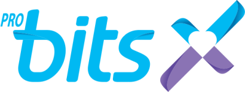

<div align="center">

<h1 align="center">
  
  <sub>Hackathon : Team 01</sub>
</h1>


### Små reflektioner. Stora förändringar.

En mobilanpassad webbapplikation som hjälper användare att reflektera över sitt mående, förstå sina vanor och skapa förutsättningar för hållbar personlig utveckling.


**48 timmar · 4 utvecklare**


</div>

---

## 🌿 Om projektet

**Hur skapar vi vanor som faktiskt håller över tid?**

Under ProBITS Hackathon utforskade vi hur digitala verktyg kan stötta människor i att utveckla och bibehålla hälsosamma vanor. Vi valde att fokusera på **reflektion som en viktig del av beteendeförändring**.

Att genomföra en aktivitet är ett steg framåt, men att också reflektera över hur den påverkade oss kan bidra till större självinsikt och motivation över tid.

Resultatet blev en mobilanpassad webbapplikation där användaren kan planera aktiviteter, registrera sitt mående och återvända till tidigare reflektioner. Målet är en upplevelse som känns **enkel, personlig och uppmuntrande**.

---

## ✨ Funktioner

### 📅 Aktiviteter och kalender

- Överblick över veckan och planerade aktiviteter.
- Kalender som kopplar samman dagar, aktiviteter och reflektioner.
- Möjlighet att se hur måendet varierar över tid.

### 💭 Reflektioner

- Registrera mående med hjälp av tydliga humörval.
- Välja faktorer (`tags`) som påverkat upplevelsen.
- Skriva en personlig anteckning.
- Koppla reflektionen till en aktivitet via `activityId`.
- Spara och återbesöka reflektioner.


### 🌸 Personlig coach
- En mänsklig coach som stöttar användaren i sin personliga utveckling.
- Möjlighet att dela reflektioner och upplevelser med sin coach.
- Ger coachen en bättre förståelse för användarens mående, framsteg och utmaningar.
- Skapar förutsättningar för personlig återkoppling och individanpassat stöd.


---


## 📱 Design och användarupplevelse

Vi valde en responsiv webbapplikation med **mobile-first-perspektiv**, eftersom aktivitetsplanering och reflektion ska vara lättillgängligt i vardagen.

Designen utgår från tre principer:

- **Enkelhet:** Det ska gå snabbt att registrera en reflektion.
- **Tydlighet:** Kalender, aktiviteter och mående ska vara lätta att förstå.
- **Positiv förstärkning:** Upplevelsen ska uppmuntra användaren snarare än bedöma prestationer.

Figma användes som utgångspunkt för design och användarflöden, som sedan implementerades i React.

<!-- Lägg gärna in en skärmbild från applikationen här. Exempel:

-->

---

## 🛠️ Teknik och arkitektur

Frontend och backend är separata delar som kommunicerar genom ett REST API.

| Del | Teknik | Ansvar |
| --- | --- | --- |
| Frontend | React, Vite, JavaScript | Gränssnitt och interaktion |
| Styling | CSS | Responsiv, mobilanpassad design |
| Backend | Java 21, Spring Boot | REST API och applikationslogik |
| Databas | H2 | Lagring under utveckling och demo |
| Kommunikation | HTTP, JSON | Datautbyte mellan frontend och backend |
| Versionshantering | Git, GitHub | Samarbete och kodgranskning |
| Deployment | Render | Publicering av applikationens delar |

### Systemöversikt

```text
           👤 Användare
                |
                v
        React + Vite
           Frontend
                |
             REST API
                |
                v
       Java + Spring Boot
            Backend
                |
                v
           H2 Database
```

Frontend hanterar presentation och användarinteraktion. Backend ansvarar för API:et, behandling av data och datalagring.

---

## 🔗 Data och API

Reflektioner skickas mellan frontend och backend som JSON. En reflektion kan innehålla information om datum, mående, valda taggar, fritext och en kopplad aktivitet.

De huvudsakliga resurserna i projektet är **aktiviteter**, **reflektioner** och **återkoppling från coach**.

### API-endpoints

| Metod | Endpoint | Beskrivning |
|---|---|---|
| GET | `/api/activities` | Hämtar tillgängliga aktiviteter |
| GET | `/api/activities/{id}` | Hämtar en specifik aktivitet |
| POST | `/api/activities` | Skapar en aktivitet |
| GET | `/api/reflections` | Hämtar sparade reflektioner |
| POST | `/api/reflections` | Skapar en ny reflektion |

### Exempel på JSON

```json
{
  "mood": 4,
  "tags": ["Energi", "Gemenskap"],
  "note": "Promenaden gjorde mig gladare!",
  "activityId": 1
}
```

---


## 🚀 Kör projektet lokalt

Projektet innehåller två huvuddelar:

```text
probits-hackathon-team01/
├── backend/         # Spring Boot REST API
└── frontend/        # React + Vite
```

### 1. Klona repot

```bash
git clone https://github.com/xffie/probits-hackathon-team01.git
cd probits-hackathon-team01
```

### 2. Starta backend

Java 21 och Maven behövs.

```bash
cd backend
mvn spring-boot:run
```

### 3. Starta frontend

Öppna en separat terminal i projektets rotmapp:

```bash
cd frontend
npm install
npm run dev
```

Öppna adressen som Vite visar i terminalen. Frontend måste vara konfigurerad att anropa rätt backend-URL.

---

## 🤝 Arbetsprocess och samarbete

Projektet utvecklades under ett **48 timmar långt hackathon** av ett team med fyra utvecklare. För att hinna från idé till fungerande prototyp delade vi upp arbetet i olika ansvarsområden och integrerade delarna löpande.

Vi använde:

- **GitHub** för versionshantering och gemensamt arbete.
- **Feature branches och pull requests** för parallell utveckling och kodgranskning.
- **Figma** för att diskutera design och användarflöden.
- **Render** för att göra applikationen tillgänglig som demo.

En central utmaning var att få kalender, aktiviteter, reflektioner och coachens feedback att fungera som en sammanhängande upplevelse, trots den korta utvecklingstiden.

---

## 🌱 Framtida utvecklingsmöjligheter

Applikationen är en prototyp framtagen under ett 48-timmars hackathon, men konceptet har stor potential att utvecklas vidare.

Under projektets gång diskuterades flera möjliga vidareutvecklingar:

- 🤖 **AI-assisterad coachning** : Introducera en AI-coach som kompletterar den mänskliga coachen genom att erbjuda stöd, vägledning och uppmuntran mellan personliga samtal.
- 🤝 **Community och gemenskap** : Skapa möjlighet för användare att ansluta till grupper med liknande mål och intressen, där de frivilligt kan dela aktiviteter, reflektioner och framsteg.
- 📊 **Personliga insikter och mönster** : Visualisera hur aktiviteter och mående hänger samman över tid, för att hjälpa användaren att förstå vad som påverkar det egna välbefinnandet.
- 🎯 **Individanpassade mål** : Ge användaren möjlighet att sätta personliga mål och följa sin utveckling i sin egen takt.
- 🔐 **Användarkonton och personlig historik** : Ge varje användare en egen profil där aktiviteter, reflektioner och framsteg sparas över tid, vilket möjliggör en mer personlig och långsiktig uppföljning.


---

<div align="center">

### 💚 Byggt under ProBITS Hackathon 2026

*Vi tror att hållbara vanor börjar med små steg*

**Team 01**

</div>
